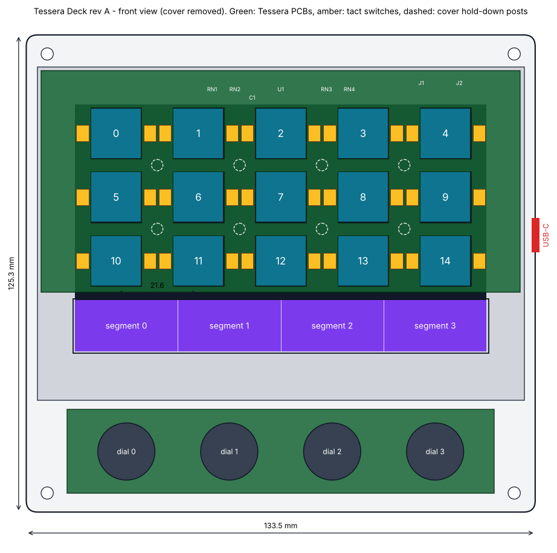
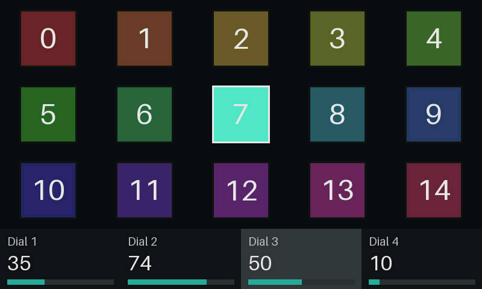

# Tessera Deck

An open-hardware macro deck in the class of a Stream Deck +: **15 LCD keys,
4 dials and an 800 x 100 touch strip**, built around one off-the-shelf 5 inch
display module, with open firmware, an open wire protocol, a Python library,
and a plugin for [OpenDeck](https://github.com/nekename/OpenDeck) so that
Stream Deck SDK plugins drive it.



What the firmware draws (this is a screenshot from the simulator running the
`tessera demo` hardware test):



## How it works

One 800 x 480 touch panel sits under everything. A thin PCB with fifteen
windows lies on the glass; a clear cap in each window carries its 96 x 96 pixel
image to the surface and clicks on two tact switches. The bottom 100 rows of
the panel stay open as the touch strip, and four encoders sit below it. The
display module's ESP32-S3 runs the firmware and talks USB. Details:
[hardware/README.md](hardware/README.md).

```
 plugins (Stream Deck SDK)          your own scripts
          |                                |
      OpenDeck  -- opendeck-tessera     tessera (Python)
                         \                /
                     Tessera Deck Protocol over USB serial
                                  |
                 firmware: portable core + ESP32-S3 port
                                  |
        5" display module + key frame PCB + encoder PCB + printed case
```

## What is in the repository

| path | contents | licence |
|---|---|---|
| `firmware/core` | portable firmware: protocol, input handling, JPEG decode, power | MIT |
| `firmware/esp32s3` | ESP-IDF port for the Waveshare ESP32-S3-Touch-LCD-5 | MIT |
| `firmware/sim` | the same core as a PC program, for development without hardware | MIT |
| `host/python` | `tessera` library and command-line tool | MIT |
| `host/opendeck-plugin` | OpenDeck device plugin (Rust) | MIT |
| `hardware` | case and keycap CAD, PCB outlines, placement, netlists, BOM | CERN-OHL-P-2.0 |
| `docs` | [protocol](docs/protocol.md), [Stream Deck compatibility](docs/stream-deck-compatibility.md), [building](docs/building.md), [simulator](docs/simulator.md) | MIT |

## Status: design complete in simulation, not yet built

Be clear-eyed about this before ordering parts.

**Tested**

- Firmware core: 98 unit checks, clean under AddressSanitizer and UBSan.
- Python library and CLI: 12 tests against the simulator.
- OpenDeck plugin: an end-to-end test with a mock OpenDeck on one side and the
  simulator on the other, both directions.
- Mechanics: interference checks between cover, tray, caps (at rest and
  pressed), PCB, switches and the display envelope; clearance asserts.
- Electrical: netlists checked pin by pin against the firmware's pin map and
  the placement files.

**Not yet done or not yet proven**

- No deck has been built. The case has not been printed.
- The ESP32-S3 port (`firmware/esp32s3`) has not been compiled or run on a
  board; only the portable core is tested. CI builds it on every push, so the
  first run will show any compile errors.
- The two PCBs are not routed: outline, placement and netlist exist, copper
  does not. See [hardware/README.md](hardware/README.md).
- The plugin has been tested against OpenDeck's protocol, not inside the
  OpenDeck application.
- One mechanical assumption (where the pixel area sits inside the display
  window) must be measured on a real module; the splash screen is designed for
  that check.

## Try it in five minutes, no hardware

```sh
cmake -S firmware -B firmware/build -G Ninja && cmake --build firmware/build
firmware/build/tessera-sim &

pip install -e host/python
tessera -d tcp://127.0.0.1:47800 info
tessera -d tcp://127.0.0.1:47800 demo &

python3 - <<'EOF'
from tessera.simctl import SimControl
sim = SimControl()
sim.key(7, True); sim.turn(2, 5)
sim.screenshot("/tmp/deck.ppm")       # open it: key 7 lit, dial 3 moved
EOF
```

```python
from tessera import Deck, KeyEvent

with Deck.open() as deck:              # auto-detects the USB port
    deck.set_brightness(80)
    deck.set_key_image(0, "icon.png")
    for event in deck.events():
        if isinstance(event, KeyEvent) and event.pressed:
            print("key", event.key)
```

## Does it do everything a Stream Deck does?

On the hardware side it matches the Stream Deck +'s feature set with more
keys: LCD keys, push dials, a touch strip of the same resolution, brightness,
sleep and a custom boot screen. On the software side, profiles, pages, folders,
multi-actions and plugins come from OpenDeck. It does **not** work with
Elgato's own application and does not pretend to be Elgato hardware. The full
comparison, including the gaps, is in
[docs/stream-deck-compatibility.md](docs/stream-deck-compatibility.md).

## Contributing

See [CONTRIBUTING.md](CONTRIBUTING.md). The most valuable things right now:
routed PCBs, a first build with measurements, and a run of the ESP32-S3
firmware on a real module.

Tessera Deck is an independent project. "Stream Deck" and "Elgato" are
trademarks of Corsair Memory, Inc., used here only to describe compatibility.
