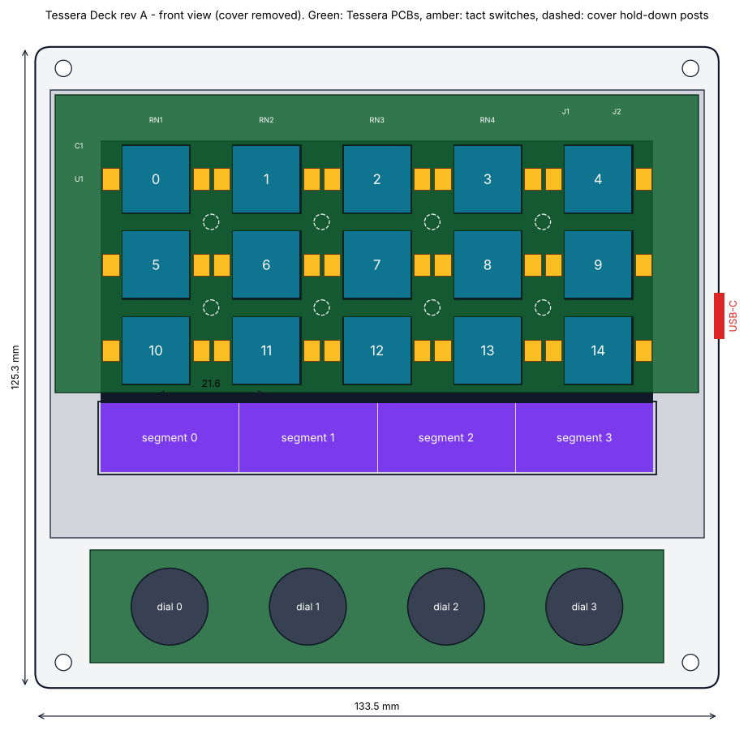
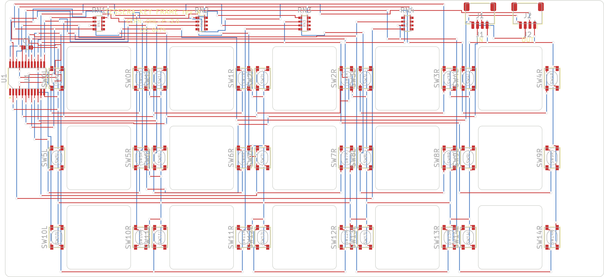
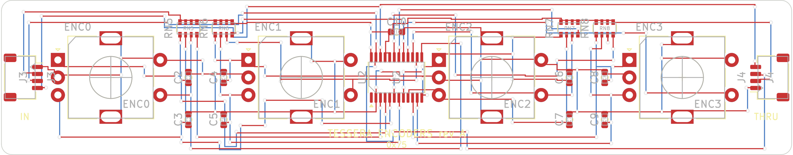

# Hardware, rev A



## The idea

Fifteen little LCDs are expensive and hard to buy. One 5 inch panel is neither.
Rev A puts a single 800 x 480 touch display under everything:

- A thin PCB with fifteen square windows lies directly on the display glass.
  In each window sits a clear cap, a light pipe that carries the 96 x 96 pixel
  image underneath it up to the surface. Two wings on each cap rest on two
  small tact switches soldered next to the window, so the cap has real travel
  and a real click. The display's touch layer is not used for the keys.
- The bottom 100 pixel rows of the same panel stay uncovered and touchable:
  that is the touch strip.
- Four rotary encoders sit below the display on a second PCB, each centred
  under one quarter of the strip.

Both PCBs carry the same circuit: an I2C port expander with pull-ups. They
plug into the display module's I2C header, so the only "main board" is the
display module, bought assembled.

| | |
|---|---|
| Size | 133.5 x 125.3 x 24.8 mm without caps and knobs |
| Display module | Waveshare ESP32-S3-Touch-LCD-5, 800 x 480 (ESP32-S3-WROOM-1-N16R8, GT911 touch) |
| Keys | 15, 13.0 mm clear caps on a 21.6 x 16.7 mm grid, 0.25 mm travel |
| Dials | 4 x EC11 with push switch |
| Strip | 108 x 13.5 mm, 800 x 100 px |

## Files

Everything is generated from `mech/geometry.py`, the single source of every
dimension, which is itself checked against the firmware's pixel layout.

| path | what |
|---|---|
| `mech/geometry.py` | dimensions and clearance checks |
| `mech/make_drawings.py` | writes the PCB outlines (DXF), placement files and the front view |
| `case/case.py` | CadQuery model of cover, tray and keycap; exports STEP and STL and runs interference checks |
| `electrical/netlist.py` | the two circuits as data; writes netlists and the BOM, checks them against the firmware pin map |
| `out/*.step`, `out/*.stl` | cover, tray, keycap, and `assembly.step` with the display envelope |
| `pcb/build_boards.py`, `pcb/router.py` | builds the two KiCad boards from the placement and netlist files, routes them, runs KiCad's DRC and exports the fabrication files |
| `pcb/key-frame/key-frame.kicad_pcb`, `pcb/encoder/encoder.kicad_pcb` | the routed boards (KiCad 7) |
| `pcb/fab/*-gerbers.zip` | Gerbers and Excellon drill files, ready to upload to a board house |
| `pcb/fab/*-positions.csv`, `pcb/fab/*-drc.rpt`, `pcb/fab/*.png` | pick-and-place centroids, KiCad's DRC report, a rendering |
| `out/key-frame-pcb.dxf`, `out/encoder-pcb.dxf` | board outlines, window cut-outs, part bodies, keep-outs (layers `OUTLINE`, `CUTOUT`, `PARTS`, `KEEPOUT`, `NOTES`) |
| `out/*-placement.csv` | reference designator, part, x, y (mm from the board's top-left corner, y down; part centre, for an encoder the shaft axis), rotation (KiCad's, counter-clockwise) |
| `out/*-netlist.csv` | net, reference, pin |
| `out/bom.csv` | everything for one deck |

Regenerate with:

```sh
pip install cadquery ezdxf pillow matplotlib numpy
python3 hardware/mech/make_drawings.py       # outlines and placement
python3 hardware/electrical/netlist.py       # netlists and BOM
python3 hardware/pcb/build_boards.py         # boards, routing, DRC, Gerbers (needs KiCad 7; about 6 minutes)
python3 hardware/case/case.py                # printed parts and fit checks
```

`python3 hardware/pcb/build_boards.py --check` only re-checks the committed
boards: every pad on the net the netlist names, every part where the placement
file puts it, nothing under the cover's posts, and a clean KiCad DRC.

## Circuit

```
display module I2C header (3V3, GND, SDA = GPIO8, SCL = GPIO9)
        |  4-wire cable
   J1 [ key frame PCB ] J2 ---- Qwiic cable ---- J3 [ encoder PCB ] J4 (spare)

key frame:  U1 TCA9539 at 0x74   P00-P07 = keys 0-7, P10-P16 = keys 8-14
            each key: two switches in parallel to GND, 10 k pull-up to 3V3
encoders:   U2 TCA9539 at 0x75   P00/P01 = dial 0 A/B ... P06/P07 = dial 3 A/B
            P10-P13 = push 0-3; A and B have 10 k pull-ups and 10 nF to GND
```

The firmware polls both expanders (encoders at 1 kHz, keys at 250 Hz), so the
INT pins are left unconnected. The full pin-level netlist is in `out/`.

The addresses 0x74 and 0x75 are clear of everything on the display module's
bus (CH422G at 0x20-0x27 and 0x30-0x3F, GT911 at 0x5D or 0x14, RTC at 0x51).

## The boards





Red is the component side, blue the other side.

| | key frame | encoder board |
|---|---|---|
| Size | 125.7 x 58.2 mm, 15 routed windows | 112 x 22 mm |
| Layers, thickness | 2, 1.0 mm | 2, 1.6 mm |
| Parts | 38, all surface-mount, component side only | 20; the encoders are through-hole |
| Tracks, clearance | 0.15 mm, 0.2 mm (drawn with 0.3 mm or more) | same |
| Vias | 0.6 mm pad, 0.3 mm drill | same |
| Copper to board edge | 0.3 mm or more | same |

These rules are inside the standard, cheapest service of the usual prototype
board houses. Order the key frame in black solder mask, with the vias tented.

Footprints are the KiCad library's: `SW_SPST_PTS810`,
`TSSOP-24_4.4x7.8mm_P0.65mm`, `R_Array_Convex_4x0603`, `C_0603_1608Metric`,
`JST_SH_SM04B-SRSS-TB_1x04-1MP_P1.00mm_Horizontal` and
`RotaryEncoder_Alps_EC11E-Switch_Vertical_H20mm`.

On the key frame the port expander stands in the margin left of the first key
column, the four pull-up arrays in the strip above the top row, and the two
connectors top right, opening towards the top edge. On the encoder board the
connectors open towards the two short edges.

The routing is done by `pcb/router.py`, a small grid router written for these
two boards, and it shows: tracks are orthogonal, and there are more vias than
a person would use (331 on the key frame, 155 on the encoder board). That is
harmless for switch signals and a 100 kHz I2C bus, and KiCad's design-rule
check passes with no violations and no unconnected pads, but nobody should
mistake it for a hand-polished layout. There is no ground pour, on purpose:
the key frame lies on a capacitive touch panel and the less copper faces it,
the better.

## What is finished and what is not

Finished: dimensions, 3D parts with clearance checks, routed boards with
fabrication files, BOM.

**Not finished: none of it has been made.** The boards have passed design-rule
checks, not a fab's review and not a soldering iron.

Check on real parts before ordering:

1. **Active-area position.** `geometry.py` assumes the 108.0 x 64.8 mm pixel
   area is centred in the display's viewing window (marked `ASSUMED`). Flash
   the firmware on a bare module first: the splash draws the fifteen key
   outlines, so a ruler tells you whether the offsets are right. An error
   shifts every window, so fix it in `geometry.py` and rebuild the boards.
2. **Footprints against your parts.** The library footprints match the part
   numbers in the BOM. If you substitute a switch or an encoder, compare its
   drawing with the footprint first. The switch footprint must give the 2.5 mm
   height the keycap stack-up assumes.
3. **I2C header.** Confirm the pin order of the module's I2C connector
   against its silkscreen before making the first cable, and measure its
   supply pin: it must be 3.3 V. The vendor schematic shows a selectable
   `I2C_VCC`; at 5 V the expanders would not read the 3.3 V bus reliably.
4. **Touch panel under copper.** The key frame's back-side tracks lie on the
   touch glass. The firmware ignores touches outside the strip, but whether
   the controller's baseline is disturbed near the strip is untested. If it
   is, a strip of polyimide tape under the board's lower edge is the first
   thing to try.
5. **Room above the parts.** The cover leaves 4.2 mm above the key frame; the
   tallest part there is the JST header at about 3 mm. The case model checks
   the boards and switches against the cover, not these small parts.
6. **The stack-up has only been checked in CAD**: cap wing on switch plunger,
   0.25 mm travel, 0.5 mm between light pipe and glass.

## Making the parts

- **Keycaps** must be optically clear. SLA-print in clear resin and polish
  the top and bottom faces, or mill them from cast acrylic. A light frosting
  on the top face hides fingerprints at a small cost in sharpness.
- **Cover and tray** print in PETG or ASA at 0.2 mm, cover top-face down, no
  supports needed for the tray. The cover's posts press the key frame PCB onto
  the glass; do not thin them.
- **Key frame PCB**: 1.0 mm thick, black solder mask (it is visible between
  the keys), tented vias. All parts are on one side; the other lies on the glass.

## Assembly order

1. Solder both PCBs. Test them on the bench with a cable before closing
   anything: `tessera demo` lights each key and counts each dial.
2. Press four M3 heat-set inserts into the tray's corner posts.
3. Screw the display module to the tray's four posts through the floor
   (M2.5 x 6 into the module's own standoffs).
4. Fit encoders through the cover's dial holes from below and fasten with
   their nuts; this holds the encoder PCB.
5. Lay the key frame PCB on the glass, cable routed through the channel at the
   top right. Drop the fifteen caps into their windows.
6. Lower the cover over the caps, four M3 screws, knobs on.

## Licence

The hardware design files in this directory are licensed under
CERN-OHL-P-2.0 (see `LICENSE`). The display module is a commercial product of
Waveshare and is not covered.
